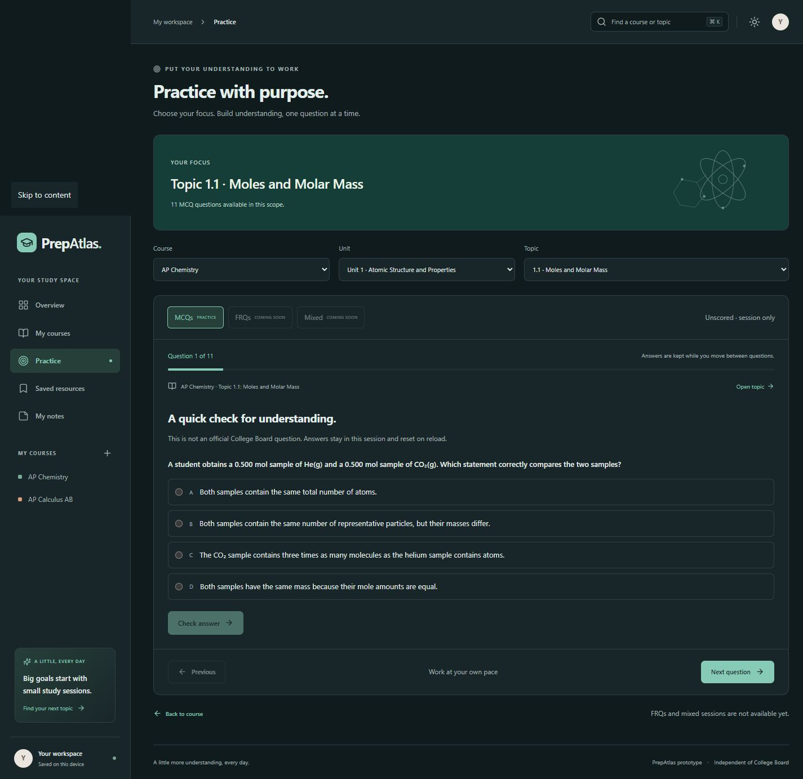
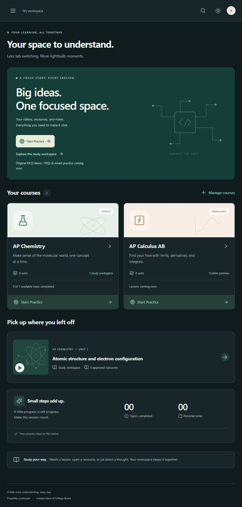
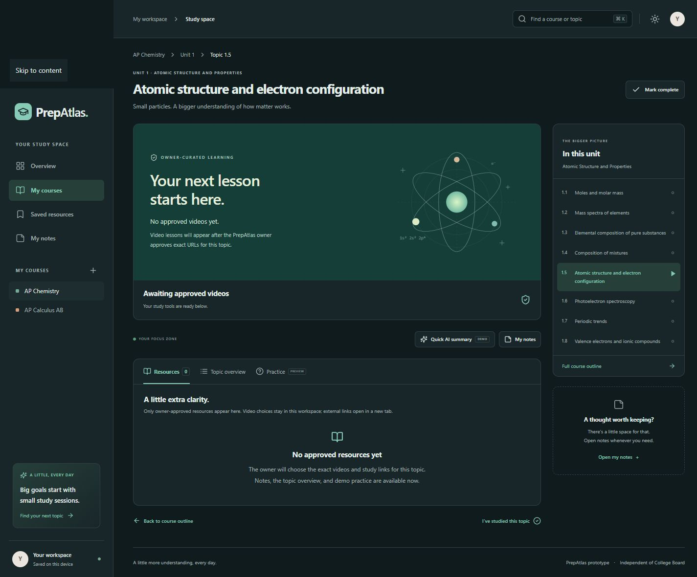
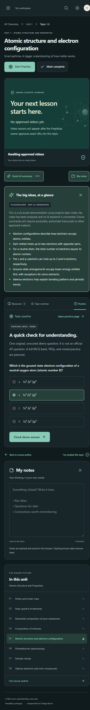
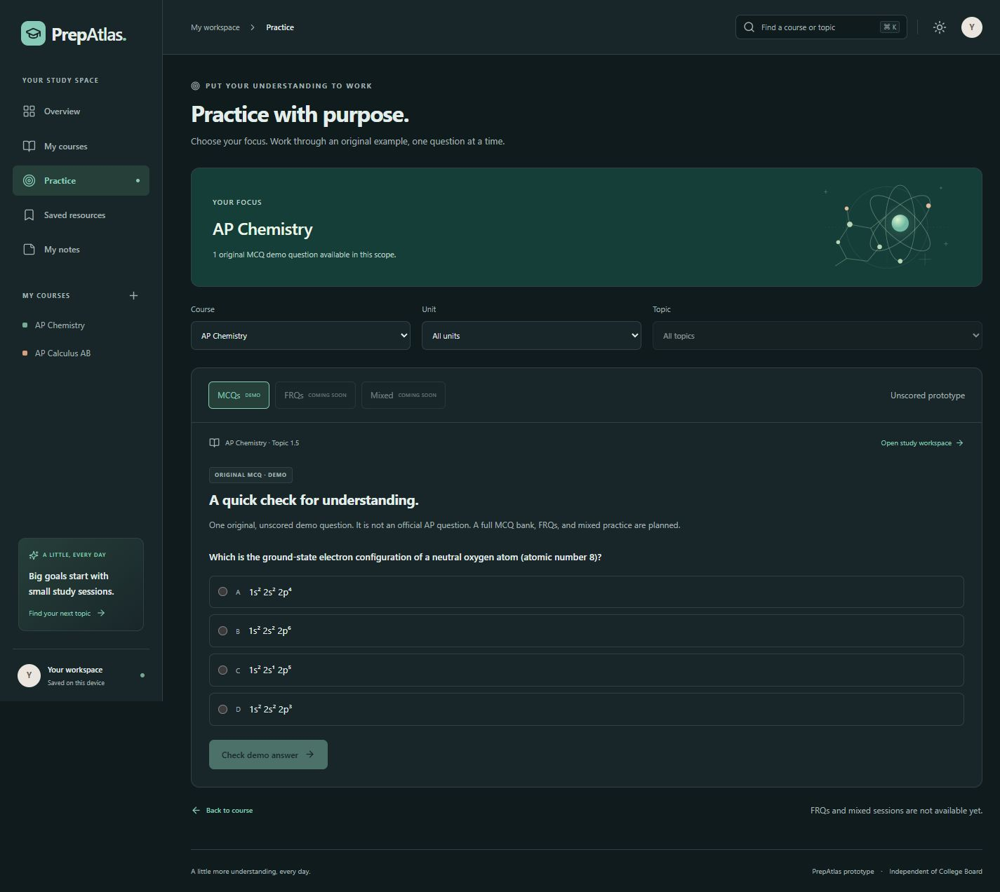

# PrepAtlas milestone verification

## Human Geography Topics 6.5–6.6

605 original MCQs across 55 topics are published, eleven each; 220 meaningful stimuli (36.36%) and 237 explicit evidence/numerical/geometry checks. Internal-city models use original concentric, sector and multiple-nuclei abstractions and contextual regional comparisons. Density independently checks dwelling units per hectare, unchanged-boundary infill, housing mix and gross/net population densities.

All 182 unit tests, structural/evidence checks, TypeScript, production build, all 68 Geography topic scopes and standard preview checks passed. Both full browser sessions scored 11/11; all eight new mobile stimuli were inspected, with keyboard zoom 200/reset 100 and desktop light-mode infill also checked. Existing 225 checkpoint question files, 212 stimuli and the complete approved catalog remain semantically unchanged. Student data and preview are preserved. Next 6.7; 13 topics/143 questions remain. Full 748-question audit and subsequent UI/summary phase remain pending. Automated review is not independent human review or empirical difficulty calibration.

## Human Geography Topics 6.3–6.4

583 original MCQs across53 topics are published, eleven each;212 meaningful stimuli (36.36%) and229 explicit evidence/numerical/geometry checks. Cities/Globalization separates population from coordinating functions, organizational networks, near/far contracting and cultural connections. Size/Distribution independently checks primacy4:1, ideal rank-three4 million, gravity indices1000/500 and seven adjoining central-place hexagons. Geometry is original and verified in rendered pixel scale; it is a general threshold example, not a strict K=3 diagram.

All180 tests, structural/evidence checks, TypeScript, production build, all68 Geography scopes and standard preview checks passed. Both full sessions scored11/11; all eight mobile stimuli inspected. Central-place keyboard zoom200/reset100 and desktop light-mode geometry passed. Existing223 checkpoint question files,204 stimuli and complete approved catalog remain semantically unchanged; student data and preview preserved. Next6.5;15 topics/165 questions remain. Full748 audit and UI/summary phase still pending; no independent human-review or empirical-calibration claim.

## Human Geography Topics 6.1–6.2

561 original MCQs across51 topics are published, eleven each;204 meaningful stimuli (36.36%) and221 explicit evidence/numerical/geometry checks. Urban Origins distinguishes local site, changing situation, growth/reclassification and urban shares. Cities Across the World assesses comparable size thresholds, peripheral job/residential forms, within-metro redistribution and separated development. All city data and shapes are original/hypothetical; source terminology verified.

All178 tests, structural/evidence checks, TypeScript, production build, all68 Geography scopes and standard preview checks passed. Both full sessions scored11/11 and all eight mobile stimuli were inspected. The peripheral corridor was routed through X and its label moved clear of the point. A max2.4 floating-point tick was detected on the new redistribution chart; max4 now gives whole-number ticks with unchanged data. A shared rendering regression checks every published chart text for long decimal artifacts. No general UI refinement begun. Desktop light/mobile dark checks passed. Existing221 question files,196 stimuli and approved catalog unchanged; student data untouched. Next6.3;17 topics/187 questions remain. The final748 audit and later UI/summary phase are still pending. No human-review or empirical-calibration claim.

## Human Geography Unit 5 complete — Topics 5.11–5.12

539 original MCQs across49 topics are published, eleven each;196 meaningful stimuli (36.36%) and213 explicit evidence/numerical/geometry checks. Units1–5 are complete. Contemporary Agriculture adds context-specific crop-trait trials, store travel, advance-payment/harvest-sharing terms and aquaculture ratios. Women in Agriculture separates workers/owners, task participation, applicant approval rates and regional management from rights, causes or individual roles. All evidence original and hypothetical.

All175 tests, structural/evidence checks, TypeScript, production build, all68 Geography scopes and standard preview checks passed. Both full browser sessions scored11/11; all eight mobile stimuli inspected plus the management map on desktop in light mode. All172 Chemistry/Calculus lessons and all91 Chemistry Practice topics/nine units/course passed regression checks. Existing219 question files,188 stimuli and complete approved catalog remain semantically unchanged. Notes, browser keys, watched state and feedback untouched.

Next6.1 — The Origin and Influences of Urbanization;19 topics/209 questions remain. The full748-question final audit is still pending bank completion. The owner’s new UI/Topic Summary phase is explicitly deferred until that audit passes; see NEXT_DEVELOPMENT_PHASE.md. No independent human review, empirical difficulty calibration or public deployment claimed.

## Human Geography Topics 5.9–5.10

517 original MCQs across47 topics are published, eleven each;188 meaningful stimuli (36.36%) and205 explicit evidence/numerical/geometry checks. Global System covers international production stages, export-revenue shocks, a signed grain account and landed costs. Consequences covers salt accumulation, sediment reduction, original wetland conversion and combined paid/unpaid workloads. Primary FAO/UNCCD definitions checked; all four options explained and causal limits retained.

All173 tests, structural/evidence checks, TypeScript, production build, all68 Geography scopes and standard preview checks passed. Both complete browser sessions scored11/11; all eight mobile stimuli inspected. The wetland outlet was moved below the field boundary after desktop inspection, then rechecked in mobile dark and desktop light mode. Existing217 checkpoint question files,180 stimuli and complete approved catalog remain semantically unchanged; student storage and preview preserved. Next5.11;21 topics/231 questions remain. No independent human review or empirical difficulty calibration claimed.

## Human Geography Topics 5.7–5.8

495 original MCQs across45 topics are published, eleven each;180 meaningful stimuli (36.36%) and197 explicit evidence/numerical/geometry checks. Spatial Organization traces an original grain/flour/bread chain, capacity-limited scale economies, operated-land concentration and net stage accounts. VonThünen uses original rings, rent-bid lines, equal-distance/different-rate corridors and competing-market accounts; equality independently solved at12 km with bids480. Assumptions and modern limitations are explicit.

All171 tests, structural/evidence checks, TypeScript, production build, all68 Geography scopes and standard preview routes passed. Both full browser sessions scored11/11, all eight mobile stimuli inspected, keyboard ring zoom200/reset100 verified, and the rent graph checked on desktop in light mode. Existing215 checkpoint question files,172 stimuli and the complete approved catalog remain semantically unchanged; no student storage edits. Next5.9;23 topics/253 questions remain. Automated validation does not constitute independent human review or empirical difficulty calibration.

## Human Geography Topics 5.5–5.6

473 original MCQs across43 topics are published, eleven each;172 meaningful stimuli (36.36%) and188 explicit evidence/numerical/geometry checks. Green Revolution questions assess seed/input interactions, uneven access, irrigation-area expansion offsetting lower unit water use, net farm returns and conditional land sparing. An initial water-balance draft was replaced before publication because it resembled1.5 too closely. Production Regions distinguishes household/sales shares, rent-paying capacity, regional crop concentration and rotation versus simultaneous intercropping;5.7 commodity-chain content is reserved for the next topic.

All169 tests, structural/evidence checks, TypeScript, production build, all68 Geography scopes and standard live-preview routes passed. Both complete browser sessions scored11/11; all eight new stimuli inspected at390×844, and the crop-share map checked in desktop light mode. Natural spacing prevents crop names splitting into isolated letters. Existing213 checkpoint question files,164 stimuli and the entire approved catalog remain semantically unchanged. Student storage untouched; preview preserved. Next5.7;25 topics/275 questions remain. Automated checks are not independent human review or empirical difficulty calibration.

## Human Geography Topics 5.3–5.4

451 original MCQs across41 topics are published, eleven each;164 meaningful stimuli (36.36%) and179 explicit evidence/numerical/geometry checks. Origins/Diffusions adds original continental hearth and crop-transfer sketches, historical-evidence comparison and adoption trends. Second Agricultural Revolution separates land/labor productivity, relative food per person, spatial consolidation and a matched seed-placement trial. All four options receive explanations; facts and causal limits are recorded in topic QA.

All167 tests, structural/evidence checks, TypeScript, production build, all68 Geography scopes and standard preview routes passed. Both full browser sessions scored11/11; all eight stimuli inspected at390×844, plus the parcel map on desktop in light mode. Optional map label anchors retain old defaults and reject invalid positions. Alternating strip labels were staggered after mobile inspection. Initial sandbox-only file/network permission failures were resolved by rerunning with approved local access; no preview restart. Existing checkpoint content, stimuli and approved catalog were compared semantically; student storage untouched. Next5.5;27 topics/297 questions remain. Automated checks do not constitute human review or empirical difficulty calibration.

## Human Geography Topics 5.1–5.2

429 original MCQs across39 topics are published, eleven each;156 meaningful stimuli (36.36%) and171 explicit evidence/numerical/geometry checks. Introduction to Agriculture separates climate constraints, total versus per-hectare inputs, seasonal grazing and whole-cycle fallow land. Rural Settlement/Survey Methods uses four original maps to separate residential concentration, linear frontage, a partial rectangular survey and a deed-referenced parcel.

All164 tests, structural/evidence checks, TypeScript, production build, all68 Geography scopes and standard live-preview routes passed. Both complete browser sessions scored11/11; all eight new stimuli were inspected at390×844. The deed parcel includes the same intermediate creek vertex as its referenced boundary; mutation checks reject a conflicting chord or creek. A field outline was made convex after mobile inspection so its default label stays inside. Desktop light-mode review also separated S/Creek labels from the line; the final shared creek bend and polygon match, and mobile dark mode passed again. Existing209 question files and148 stimuli at aac3155, plus the entire approved catalog, remain unchanged. No student storage edits, human-review or empirical difficulty-calibration claim. Next5.3;29 topics/319 questions remain.

## Human Geography Unit 4 complete

407 original MCQs across all37 official topics in Units1–4 are published, eleven each. There are148 meaningful stimuli (36.36%) and162 explicit evidence/numerical/geometry checks. Topics4.9–4.10 compare internal authority, independent statehood, varied international mandates, cross-border environmental links, pooled costs, group/state cohesion and uneven institutional reach. Different denominators and possible rather than inevitable consequences are explicit.

All162 unit tests, structural/evidence checks, TypeScript, production build, all68 Geography scopes and standard live-preview routes passed. Both new full Practice sessions scored11/11; all eight stimuli passed390×844 visual inspection. The existing207 question files and140 stimuli at89281d3, plus the entire approved resource catalog, remain semantically unchanged. Student storage code and browser notes/progress were not touched. No human-review or empirical difficulty-calibration claim. Next5.1;31 topics/341 questions remain. The full748-question audit is still pending completion.

## Human Geography Topics 4.7–4.8

385 original MCQs across35 topics are published, eleven each;140 meaningful stimuli (36.36%) and153 explicit evidence/numerical/geometry checks. Governance separates constitutionally allocated authority from delegation, local office locations, policy differences and regime type. Devolutionary factors distinguish physical access, fiscal grievances, asserted incorporation claims, separatist aims, coercive displacement, political intimidation and conditional outcomes.

All160 tests, structural/evidence checks, TypeScript, production build, all68 Geography scopes and standard routes passed. Both full browser sessions scored11/11; all eight stimuli were inspected at390×844. The separatist scenario was narrowed before publication to an explicit independent-state aim so mere autonomy is not automatically labeled separatism. Existing questions, approved resources and storage remain preserved; no human review or empirical difficulty-calibration claim. Next4.9;33 topics/363 questions remain.

## Human Geography Topics 4.5–4.6

363 original MCQs across33 topics are published, eleven each;132 meaningful stimuli (36.36%) and145 explicit evidence/numerical/geometry checks. Boundary functions cover physical marking, mapped courses, administration, maritime distances/rights, overlap and resource connections. Electoral questions use original fixed-vote maps to distinguish district grouping, statewide votes, seat outcomes, packing/cracking and evidence of intent.

All158 unit tests, structural/evidence checks, TypeScript, production build, all68 Geography scopes and standard application routes passed. Both complete browser sessions scored11/11. All eight stimuli passed390×844 inspection; the nine-precinct map also passed desktop light mode, keyboard zoom200/reset100 and review-time enlargement. The district checker validates exact grid polygons, one-time precinct coverage, equal populations, adjacency, majorities and rounded shares. A changed polygon with refreshed hashes is rejected. Answer positions and explanations were varied together before publication to avoid a repeating key cycle. Existing questions, resources and student storage remain untouched. No human review or empirical difficulty-calibration claim. Next4.7;35 topics/385 questions remain.

The first standard smoke run failed on an invalid Biology Practice scope (500 instead of404) with a preview JSON parse error. Logs were preserved; all nine development JSON manifests parsed in a later snapshot. No preview restart or cache deletion was used. A complete smoke rerun and80 no-retry preview requests subsequently passed without new parse errors. This confirms recovery, not a permanent fix; see PREVIEW_STABILITY.md.

## Human Geography Topics 4.3–4.4

341 original MCQs across31 topics are published, eleven each;124 meaningful stimuli (36.36%) and137 explicit evidence/numerical/geometry checks. Political Power/Territoriality includes routing times, constrained finance, rival-support networks and access permits. One question initially offered two defensible contrasts; hug-4-3-006 was corrected before publication and its hashes/reasoning were renewed. Boundary types distinguish form, chronology, intended correspondence and current function, explicitly allowing overlapping labels.

All156 unit tests, structural/evidence checks, TypeScript, production build, all68 Geography scopes and standard application routes passed. Both complete browser sessions scored11/11. All eight stimuli passed390×844 visual inspection. Regression also verified all172 Chemistry/Calculus lesson routes and unchanged Chemistry publication scopes. Existing question contents, videos and browser storage remain preserved; no human review or empirical difficulty-calibration claim. Next4.5;37 topics/407 questions remain.

## Human Geography Topics 4.1–4.2

319 original MCQs across 29 topics are published, eleven each; 116 meaningful stimuli (36.36%) and 129 explicit evidence/numerical/geometry checks. Political entities distinguish nations, states, citizenship, tribal self-government and regional autonomy. Political processes distinguish colonial control, independence, inherited borders, devolution and self-determination. Contemporary examples were checked against primary institutional accounts; no disputed recognition or automatic right to secession is adjudicated.

All 154 unit tests, structural/evidence checks, TypeScript, production build, all 68 Geography scopes and standard application smoke checks passed. Topic4.1 scored11/11 in a full browser session. Topic4.2 deliberately began with a wrong answer, displayed all-option feedback, accepted a correct retry and correctly retained10/11 (91%) as the first-attempt score. All eight new stimuli passed390×844 inspection. Existing question files and the approved catalog are unchanged; browser student notes/progress were not edited. No human-review or empirical difficulty-calibration claim. Next4.3;39 topics/429 questions remain.

## Human Geography Unit 3 complete

297 original MCQs across 27 topics are published, eleven each. All eight Unit 3 topics are complete. There are 108 meaningful stimuli (36.36%) and 121 explicit evidence/numerical/geometry checks. Topics 3.7–3.8 distinguish language ancestry from religious identity, carrier movement from conversion, historical names from current speech, and domain-specific adaptation from complete assimilation. AP religious categories are presented as broad curricular conventions with diversity and exceptions.

All 152 automated tests, TypeScript, production build, Geography scopes and standard route checks passed. Both new full Practice sessions scored 11/11. All eight stimuli were inspected at 390×844. Map routes were repositioned to separate text from region/point labels; review-time enlargement remains available. A typecheck launched during build-generated type replacement initially failed on missing generated files; the sequential rerun passed. Future build/typecheck runs should remain sequential. Existing question contents, resources and storage remain unchanged; no human review or empirical difficulty-calibration claim. Next 4.1; 41 topics/451 questions remain.

## Human Geography Topics 3.5–3.6

275 original MCQs across 25 topics are published, eleven each; 100 meaningful stimuli (36.36%) and 113 explicit evidence/numerical/geometry checks. Historical causes cover trade, colonial institutions, contact-language development and lingua-franca use without treating contact-language histories as uniform. Contemporary causes cover communication delays, urban/global networks, separate platform/content measures and local-language production without inferring speaker vitality from upload counts.

All 150 automated tests, TypeScript, the production build, all 68 Geography scopes and standard route checks passed. Both full Practice sessions scored 11/11. All eight new stimuli were inspected at 390×844; the communication chart passed desktop light-mode and keyboard zoom 200/reset 100 checks. Descriptions were spaced for readable mobile prose. Existing questions, videos and student storage are unchanged; no human review or empirical difficulty-calibration claim. Next: 3.7; 43 topics/473 questions remain.

## Human Geography Topics 3.3–3.4

253 original MCQs across23 topics are published, exactly11 per completed topic;92 meaningful stimuli (36.36%).104 explicit checks include numeric/geometry models and supplied-evidence assertions, not104 independent scientific proofs. Cultural Patterns examines crosscutting identities and conditional cohesion/division; Types of Diffusion distinguishes documented mechanisms from resemblance, subtype uncertainty, adaptation, movement and cross-scale channels. All148 tests, TypeScript/build, Geography scopes and standard routes passed. Both full browser sessions scored11/11; all eight stimuli passed mobile390×844 inspection.

Browser review found node labels crossed arrows. Optional above/below/left/right positions now keep the new council/hierarchy text clear; actual rendered coordinates and invalid positions are tested. Defaults preserve existing diagrams. Three stimulus headings were made neutral to avoid suggesting conclusions:2.6 demand chart,3.2 seasonal-use table and3.3 cultural-measure table. Questions, keys, explanations and data did not change. Approved resources/storage remain untouched.80 preview requests across8 routes at concurrency3 passed without retries or new manifest errors; this is not proof of a permanent fix. No human-review or empirical difficulty-calibration claim. Next3.5;45 topics/495 questions remain.

## Human Geography Topics 3.1–3.2

231 MCQs across twenty-one topics are published;84 meaningful stimuli (36.36%) and95 explicit evidence/model checks. Introduction to Culture distinguishes social transmission, one-trait distributions, within-group variation and observer attitudes. Cultural Landscapes interprets historical layers, human/environment combinations, gendered access and seasonal uses absent from building counts. All145 tests, TypeScript/build, Geography scopes and standard routes passed. Both complete browser sessions scored11/11; all eight actual stimuli were inspected at390×844. No old questions, videos or storage changed; no human review or empirical difficulty-calibration claim. Next3.3, with47 topics/517 questions remaining.

## Human Geography Unit 2 complete

209 original MCQs across nineteen topics are published: all seven Unit1 and twelve Unit2 topics, exactly11 each.76 meaningful stimuli (36.36%) and87 explicit numerical/geometry checks corroborate present sets; no unresolved item is published. Topics2.11–2.12 add displacement borders/procedures, step and seasonal movement, remittance fees/units, skilled-workforce accounting and cultural landscapes. A pending asylum claim does not establish absence of refugee circumstances. Two workforce distractor totals were corrected before publication and are now checked against their stated arithmetic mistakes.

All143 automated tests, TypeScript/build, Geography/standard routes, all172 legacy lesson routes and Chemistry publication/preservation checks passed. Both new full browser sessions scored11/11. All eight new stimuli were inspected at390×844; step-model zoom200/reset100 passed. Adding spaces to a long seasonal description removed default phone overflow (content width305, scroll width305). No existing question or catalog objects changed; no browser notes/progress were edited. This is automated verification, not independent human review or empirical difficulty calibration. The full bank is unfinished:49 topics/539 questions remain, next3.1.

## Human Geography Topics 2.9–2.10

187 MCQs across seventeen topics are published;68 meaningful stimuli (36.36%) and77 explicit checks. Aging questions distinguish counts/shares, total/old-age dependency, potential/contributor support and conditional policy consequences. Causes of Migration distinguishes after-cost opportunities, intervening destinations, travel financing, overlapping motives and departure-rate denominators. All141 automated tests, TypeScript/build, Geography scopes and standard smoke checks passed. Both complete browser sessions scored11/11; all eight actual stimuli were inspected at390×844. A transient clipped phone-table paint cleared after zoom reset; measured widths/scroll positions were normal and subsequent views were complete. No persistent layout defect or Next.js error was reproduced. Existing content/resources/storage preserved; no human review claim. Next2.11; the bank is incomplete.

## Human Geography Topics 2.7–2.8

165 MCQs across fifteen topics are published;60 meaningful stimuli (36.36%) and66 explicit numerical/geometry checks. New policy questions distinguish intent, instrument, local access, migration composition, causal attribution and cohort timing. Women/demographic-change questions interpret education associations, contextual migration sex shares, paid/unpaid care and maternal mortality ratios using live births. All139 tests, TypeScript/build, Geography scopes and standard smoke checks pass. Every new answer was graded in two full browser sessions, each11/11. All eight stimuli were inspected at390×844 with readable tables, legends and chart units. Existing question/resource objects and storage are unchanged. No independent human review is claimed. Next2.9; full bank unfinished.

## Human Geography Topic 2.6 — Malthusian theory and critiques

143 MCQs across thirteen topics are published;52 meaningful stimuli (36.36%) and57 explicit numerical/geometry checks. New evidence includes crossing demand/supply lines, changing growth rates, a productivity table and the first proportional-symbol map. Circle areas, not radii, encode food per resident. Independent accounting distinguishes sufficient aggregate food from East's400-unit deficit without transfers, and gross harvest from usable food after losses. Historical checks do not label mortality as morally beneficial or attribute modern contraceptive advocacy to Malthus.

All137 automated tests, TypeScript, production build, all68 Geography scopes and standard smoke routes passed. Every new answer was graded in a complete browser session for11/11. All four actual stimuli were inspected at390×844; map light/dark desktop contrast and100–200% keyboard zoom passed. Line labels now separate crossing series; line charts deliberately support at most two series, while bars retain three. Existing published questions, video catalog and browser storage were preserved. Automated verification is not independent human review. Next topic2.7; the full bank remains unfinished.

## Human Geography Topic 2.5 and reusable line charts

132 MCQs across twelve topics are published, with48 meaningful stimuli (36.36%). Topic2.5 adds an original four-stage DTM line schematic, rate-level comparison, subnational fertility map and mortality-cause table. The line renderer uses solid/circle and dashed/square series, numeric labels, a common zero baseline and a full equivalent data table. Categorical stage spacing is explicitly not equal-duration historical time. Browser inspection found a label touching the vertical axis; inward point margins corrected it. All eleven answers produced11/11, and mobile390×844 visuals, light/dark contrast,100–200% keyboard zoom and graded-review enlargement passed. All136 automated tests,52 explicit bank models, TypeScript/build and Geography/standard routes passed. Research sources and limits are recorded in the QA sidecar; no new third-party student resources were published. Next2.6;56 topics/616 questions remain.

## Human Geography Topic 2.4

121 MCQs across eleven topics are published;44 meaningful stimuli (36.36%) and47 explicit model checks. New checks separate natural increase from net migration, convert per-thousand rates correctly, corroborate the rule-of-70 approximation with logarithmic compounding and verify both migration-arrow directions. A floating-point equality in the checker was replaced with exact integer cross-multiplication before publication; the question’s1.4% answer was correct. All134 automated tests, TypeScript/build, Geography scopes and standard smoke checks passed. Browser grading covered all eleven questions for11/11; all four stimuli were inspected at390×844. Existing content/resources remain intact. Next:2.5;57 topics/627 questions remain.

## Human Geography Topic 2.3 — first published pyramids

110 original MCQs across ten topics are published, with40 genuine stimuli (36.36%): twelve maps, eighteen tables, six charts, three pyramids and one service diagram. All three pyramid datasets sum to100%, use a common whole-population denominator and symmetric scales, and place oldest cohorts at the top. Ten-year cohorts below80 and an explicit open80+ group avoid unequal-width age bands in shape comparisons. Forty-one explicit numerical/geometry checks corroborate the bank. All133 automated tests, TypeScript/build, Geography scopes and standard routes passed. All eleven new questions were answered/graded for11/11 in the browser; mobile pyramids/equivalent tables, keyboard100–200% zoom, light/dark contrast and review-time enlargement were checked. Diagram inspection was visual; an attempted browser geometry measurement was unsupported and is not counted as a successful automated clipping test. No human review is claimed. The full bank remains unfinished:58 topics/638 questions remain, starting2.4.

## Human Geography Topic 2.2

99 questions across nine topics are published, with36 interpreted stimuli (36.36%). New consequences questions compare service journeys despite equal clinic ratios, per-person transport energy, residents per representative and total resource demand. Independent checks distinguish counts, ratios and totals; conceptual items retain conditional carrying-capacity assumptions. All132 automated tests, TypeScript and production build passed. All eleven new answers were graded in a browser for11/11; mobile map/chart/table enlargement and review-time access were checked. A cramped table header was corrected with shorter labels, unbroken header words and tighter mobile padding. Geography scopes and standard smoke checks pass. Next:2.3; the full bank remains incomplete.

## Human Geography Topic 2.1

88 MCQs across eight topics are published; 32 meaningful stimuli (36.36%). Topic 2.1 adds three density calculations, reversed arithmetic/physiological rankings, a river-corridor map and an employment/settlement table. All eleven answers were exercised in the browser and produced 11/11. All four stimuli were inspected on mobile; plain map labels now omit the unnecessary outline on unshaded backgrounds. Thirty-one explicit model checks, 131 automated tests, TypeScript and production build passed, with all Geography scopes and standard smoke checks. No previous question/resource objects changed. The next unfinished topic is 2.2; population pyramids remain unpopulated until 2.3.

## Human Geography Unit 1 complete

77 original MCQs across all seven Unit 1 topics are published, with exactly eleven each. Twenty-eight genuine stimuli (36.36%) comprise ten maps, five charts, twelve tables and one service-network schematic. Twenty-seven explicit numerical/geometry models corroborate the bank; conceptual questions have recorded option-by-option reasoning reviews, without a claim of independent human review. Topics 1.6 and 1.7 each produced 11/11 in complete browser sessions. Mobile maps, chart/table labels and the actual clinic-node arrows were inspected; the model also passed light/dark inspection. All 130 automated tests, TypeScript, production build, all 68 Geography scopes, standard smoke checks, all 172 Chemistry/Calculus lesson routes and eighty preview-stability requests passed. No new manifest errors were observed; this is not proof of a permanent fix. Existing question/resource objects are preserved. The full bank is unfinished: next is 2.1, with 61 topics/671 questions remaining.

## Human Geography Topics 1.4–1.5

55 questions are published across five topics, with twenty interpreted stimuli (36.36%). The eight additions include spatial arrangement, travel-time accessibility, distance decay, association, aquifer balance, changing land cover, river connections and a possibilist comparison. All 128 unit tests, structural/model checks, TypeScript and production build passed. Browser sessions for each new topic produced 11/11; desktop/mobile diagrams and tables were inspected. A faint flow arrow on a shaded map was corrected with a dark stroke and light outline before saving. All 68 Geography routes, standard smoke checks and Chemistry preservation/publication checks passed. The bank is incomplete; resume at 1.6.

## Human Geography Topic 1.3

33 MCQs across three topics are now published, with twelve meaningful stimuli (36.36%). Topic 1.3 adds constrained clinic-siting data, a school/floodplain overlay, population-change bars and an observational temperature comparison. Unique eligible-site ranking, point positions, absolute/relative growth and both temperature changes are independently recomputed. All 126 unit tests, TypeScript and the production build passed. All eleven new questions were graded in the browser, producing 11/11; the map, chart and tables were inspected on desktop/mobile. Centered school labels avoid crossing region boundaries. Existing content and storage are preserved. The bank remains incomplete; next topic: 1.4.

## Human Geography Topics 1.1–1.2

22 original MCQs are published with eight genuine stimuli (36.36%). Topic 1.2 adds a data-collection chart/map and two tables, independent rate/coverage checks and a complete 11/11 browser session. All 125 automated tests, TypeScript/build, 68 topic/Practice scopes and standard smoke checks pass. Desktop/mobile charts and tables, light/dark contrast and lesson-to-Practice integration were checked. The bank remains incomplete; next topic is 1.3. See GEOGRAPHY_STIMULI.md and the progress tracker.

## Human Geography visual Practice — Topic 1.1 checkpoint

Eleven original questions are published; the full 748-question bank is still in progress. Four interpreted original map stimuli give 36.36% coverage. Structural/QA checks, five data/geometry recomputations, 124 unit tests, TypeScript and production build pass. All eleven questions were exercised in the browser, including incorrect feedback/retry and expected 10/11 first-attempt scoring. Mobile maps, enlargement/100–200% zoom, answer review and preservation were checked. Charts/pyramids/models/tables have synthetic renderer tests; they are not yet published Geography question types. See [stimulus report](GEOGRAPHY_STIMULI.md) and [actual progress](../content-drafts/human-geography/PROGRESS.md).

## Human Geography course and dual-instructor integration

Seven units and 68 CED-checked topics are registered, with 136 initial verified videos and no Human Geography MCQs at this checkpoint. TypeScript, production build, 118 automated tests, all new topic/empty-Practice scopes and existing course regressions passed. Actual representative playback/fullscreen, preference persistence, separate watched status, notes preservation, keyboard selection and mobile layout were checked. See [full report](HUMAN_GEOGRAPHY.md) for exact counts, thirteen withheld extras, limits and next question phase.

## Flipped Math Version 1 Calculus AB integration — October 19 authorization

All 81 AB topics now have one verified The Algebros Version 1 lesson. The one-time URL ledger, 30 BC-only exclusions, four non-video applet exclusions and verification limits are recorded in [the complete integration report](FLIPPED_MATH_VERIFICATION.md). All 1,892 MCQs and 102 Krug resources are preserved. TypeScript, 111 automated tests, resource validation, production build, complete topic/Practice route checks and preview stability checks passed. Representative desktop/mobile actual playback, fullscreen, note/watched persistence, Practice grading and Chemistry multipart navigation passed. No public deployment.

## Private ratings and question reporting — October 18, 2026

- Starting checkpoint: `ecd77f3c3997e48f74579d82a947603041280822`; clean main/upstream verified before editing. No published question JSON, curriculum ID, answer key, resource catalog, legacy study-storage key, Practice reducer or video component changed.
- TypeScript, **49 automated unit tests** (41 existing + 8 feedback tests), production build, question preservation/scientific publication checks and the full route regressions passed. All 1,001 MCQs / 91 topics / eleven each remain published; 102 approved unique videos and pending 9.8b alias remain unchanged.
- Development and isolated production: 20 page routes, compiled CSS, seven invalid routes, all 91 Practice topic routes/nine units/full course and all 91 Study Workspaces passed. Every Practice scope renders exactly one reporting flag for its current MCQ. Eighty concurrent preview requests passed without retries/new manifest errors; this does not establish a permanent fix for the earlier intermittent warning.
- Eight new isolated SQLite/HTTP tests cover ratings 1–5, all five reasons, 500-character limits, malformed/oversized/extra fields, missing/cross-origin sessions, canonical question metadata independent of displayed position, persistence after reopening, duplicate receipts, failed storage, report/review limits, session expiry and opt-in plus owner privacy moderation. Low-star reviews are eligible through the same moderation gate. No raw private text or administrative GET route is exposed.
- Separate production HTTP checks on port 3100 used a disposable ignored database, never the real feedback destination. Confirmed actual accepted receipts, pending/private homepage exclusion, escaped public excerpt rendering, approved low-star display, rejection/unpublication and private-route denial. Synthetic fixtures were isolated and rejected before teardown; no invented testimonial appeared in the live preview.
- Browser: real live-preview private review and report submissions returned confirmed success and were read back from `%LOCALAPPDATA%\PrepAtlas\feedback.sqlite`. These clearly labeled verification records remain private (review rejected for publication; report resolved). No genuine public reviews have been submitted or fabricated. A real initial origin-check failure preserved the form; fixing Next's localhost/127.0.0.1 Host handling allowed its same-ID retry to succeed. A regression test covers this case.
- Browser: keyboard star selection/change, unchecked public opt-in, disabled unselected submission, mobile 390×844 dialogs and desktop dark/light dialogs passed. Reporting preserved selected answer B, its open explanation and first-graded score (1/11 after finishing the isolated test session). Next question updated the report context; Escape restored focus to the flag. In the isolated production workspace, a playing lesson remained available after rating dismissal; video source, saved notes, bookmark, watched status, reload persistence, Part A/B switching and fullscreen entry/exit were checked. No application warning/error was captured in the production browser check. Original port-3000 student data was not edited for those persistence tests.
- Current destination is the local server's private SQLite file; no service account or credential is missing for local use. Future public use still needs persistent Node hosting, HTTPS origin/proxy configuration, private backups/retention and deployment abuse controls. Anonymous cookie limits are a prototype safeguard, not complete bot prevention. See FEEDBACK.md. No public deployment, paid service, account system or score-history feature was added.
- Live preview 3000 preserved. Temporary production verification server 3100 is stopped at teardown. GitHub checkpoint and verified remote SHA are reported at the end of the task; database files, verification fixtures, browser data and screenshots remain outside committed source.

## Post-publication videos and workspaces — October 18, 2026

- Chemistry preserved unchanged: all 1,001 MCQs / 91 topics / eleven per topic, frozen hashes, keys and explanations intact. No regeneration or reimport. Full numerical/scientific-model suite and frozen source audit passed.
- Under the owner's one-time collection authorization: 103 creator-directory entries resolve to 102 unique verified YouTube IDs; all 102 are approved/published across 91 topics. Fresh public metadata returned HTTP 200 for every unique video. Duplicate 9.8b points to Part A; it remains pending as a distinct lesson, not a second published video. See VIDEO_VERIFICATION.md and INITIAL_KRUG_APPROVAL.json.
- TypeScript, **41 unit tests**, production build, expanded **20-route** smoke, CSS, seven invalid routes, fixed course art and homepage rotation passed. All 91 Practice topic routes/nine units/full course and **all 91 topic workspace routes** passed on both the development preview and temporary production server. Counts, topic mapping, original links, optional notes, single-player rendering, conditional tabs and scoped Practice are checked.
- Browser: actual Topic 1.1 Parts A/B playback, page fullscreen entry/exit, YouTube native fullscreen entry/exit at 390px, watched Mark/Undo and refresh/navigation persistence, notes autosave/reload with original text restored, single-video and four-part keyboard/boundary behavior, honest Calculus empty states and an integrated 11/11 (100%) quiz with restart were verified. 390px/768px checks had no horizontal overflow. Captured application browser warnings/errors: none.
- Escape sent through the in-app browser did not exit provider fullscreen; native exit did. Do not report Escape or physical iOS/Android fullscreen as verified. Not all 102 videos were watched; directory/public metadata checks are not full lesson-content review or universal playback certification.
- Eighty requests across eight preview routes at concurrency three passed without retries/new manifest parse errors while production output was being built separately. Historical/intermittent JSON warnings remain documented in PREVIEW_STABILITY.md; no permanent root-cause fix is claimed. One preview process tree was found; no caches or student data were deleted.
- Manual watched state extends the existing local key additively. Notes/bookmarks/topic progress keep their legacy keys and meaning; Practice scores remain session-only. VIDEO_EDIT_GUIDE.md documents safe corrections and fresh approval for replacement URLs. No public deployment or paid AI.
- Temporary production server 3100 stopped after checks; development preview 3000 preserved. Checkpoint/push receipt is recorded in the final report and local ignored `tmp/postpublication-push.json` after verification.

Earlier sections retain historical milestone results and counts.

## Complete Chemistry bank publication — October 18, 2026

- **All 1,001 MCQs are available in Practice: 91 topics × eleven; zero withheld.** Owner bulk authorization supersedes prior per-question approval for the completed bank. All content/IDs/keys/explanations match the frozen checkpoint. No human scientific approval is claimed. [Publication review](../content-drafts/chemistry/PUBLICATION_REVIEW.md) resolves the documented scope, difficulty and repetition flags and records limitations.
- Structural/ID/count checks, frozen semantic hashes and preservation audit, full scientific-model suite and new publication/flagged-calculation checks passed. Original Topic 1.1, recovered objects, earlier saved banks and empty official resource catalog are preserved.
- TypeScript, all **37 unit tests** and fresh production build passed. Tests cover every key's four choices, retained selections, retry/first-score policy, incomplete sessions, boundaries, restart and a complete 1,001/1,001 score.
- Development and separate production suites passed all 19 page routes, CSS, seven invalid routes, six fixed course themes and fresh homepage rotation. Expanded publication suite passed all **91 topic routes, nine units and course scope** on both servers, verifying counts, correct first-question identity and one-question rendering.
- Browser quiz: initial incorrect answer, correct retry, then ten correct answers produced **10/11 (91%)**. Both graded and ungraded selections survived Previous/Next. Full explanations, first/last boundaries, review and restart worked. Finish with one selected/unchecked correct answer yielded **1/11 (9%)**, ten unanswered. Unit/topic filters and reload reset passed. At 390px, feedback/navigation remained usable without horizontal overflow; captured browser warnings/errors: none.
- Only selected-scope questions are passed from server pages to Practice; dashboard/course count helpers use a lightweight index, avoiding a full-bank client import. One question form is mounted at a time.
- Preview remains at `http://127.0.0.1:3000`; temporary production server 3100 was stopped. Storage keys/notes/resources/progress remain untouched. No public deployment, new resources, videos or major redesign.
- Browser proof: `C:/Users/devan/.codex/visualizations/2026/10/17/01a14a50-98cd-74d2-a847-9845fa66437d/prepatlas-published-chemistry-results.jpg`.

Earlier sections retain historical checkpoint results; their unpublished counts no longer describe the current application.

## Complete 1,001-question bank checkpoint — October 18, 2026

- All 91 topics now contain exactly 11 complete questions: 1,001 total. Only the original authorized Topic1.1 bank (11) is live; 990 remain unpublished in 90 pending sets. No missing counts or structural/ID defects remain.
- The full audit checks coverage, exact schema, unique ordered IDs, answer/explanation labels, normalized exact prompt duplicates, per-topic QA, frozen semantic hashes and preservation. All 49 Unit 6 baseline draft sets, the original approved ten objects and all 29 corrected recovered partial objects remain unchanged. Four newly authored questions completed the partials;44 new replacements fill unavailable-source topics without claiming to recover them.
- Numerical/model checks, TypeScript, all 31 unit tests and a fresh production build pass. The final normal development and temporary production smoke suites pass all 19 routes, CSS, seven 404 cases and six fixed themes; home rotation showed five/six themes in twelve responses respectively. The temporary production serverPID 17144 was stopped and preview 3000 preserved.
- Browser confirms Unit 9 has 0 live questions and 11 official topic options; Topic 1.1 still has 11 without the approval badge. No student notes or progress were edited. Earlier intermittent generated-manifest failures remain documented; final passes do not prove a permanent fix.
- See the [full-bank audit](../content-drafts/chemistry/BANK_AUDIT.md) for remaining human scientific, difficulty and variety review. No redesign, video integration, fullscreen or automatic publication was started. The current AGENTS milestone workflow authorizes a normal GitHub backup push, superseding the older handoff restriction; remote success must be verified separately.

## Unit 9 content checkpoint — October 18, 2026

- All eleven thermodynamics/electrochemistry topics have eleven-question unpublished files (121 new questions). Coverage924/1,001: eleven live and913 pending in83 sets. Seven earlier topics remain incomplete.
- Structure and science checks pass, with separate calculations, stoichiometric/electron balances and conceptual reviews. Decimal verification corrected a too-precise expected log value in the checker; the rounded question answer was already correct. This is not independent human approval.
- TypeScript, all31 tests and the full development smoke passed. No app code changed; the Unit6 production build remains representative. Preview preserved, eight home themes observed in twelve fresh responses.
- Units7–9 are finished as drafts. Return now to1.2/1.3/1.6/1.7/2.1/2.2/2.3, retaining valid recovered questions and writing only missing or justified replacement content. No publication or redesign started.

## Unit 8 content checkpoint — October 18, 2026

- All eleven acid/base topics have eleven-question unpublished files (121 new questions). Coverage803/1,001: eleven live and792 pending across72 sets. Eighteen topics remain incomplete.
- Structure/ID/count/duplicate-prompt checks and implemented science calculations pass, with separate scope/solve notes for all topics. Buffer pH-change, full polyprotic species and numerical pH-solubility exclusions are respected. Human review and owner publication approval remain pending.
- TypeScript, all31 tests and the full development smoke passed. Production build/smoke passed at Unit6 and app code is unchanged. No preview restart was needed for this unit’s passing suite.
- Next9.1 (`entropy`); finish Unit9, then only the missing earlier questions while preserving valid recovered material. Resource catalog and live registry unchanged.

## Unit 7 content checkpoint — October 18, 2026

- All twelve equilibrium topics now have eleven-question pending files (132 new questions). Total complete-file coverage is682/1,001: eleven live and671 unpublished in61 sets. Twenty-nine topics remain incomplete.
- JSON/scope/ID/count/duplicate-prompt checks and the implemented numerical/model suite pass. Root feasibility, concentration scale in particle models, gas pressure scaling, solubility stoichiometry and common-ion approximation checks are documented separately. Human scientific review remains pending.
- TypeScript and all31 unit tests pass again. Production build/full production smoke passed at Unit6; application code is unchanged. The first Unit7 development smoke caught a transient `Manifest file is empty` failure; the affected route recovered without a restart and the full unchanged rerun passed, with seven home themes in twelve responses. No permanent fix is claimed. Preview3000 is preserved.
- Next8.1 (`acids`), then the remaining Units8–9 followed by earlier recovery gaps. No pending content, videos or UI features published.

## Unit 6 content checkpoint — October 18, 2026

- All nine thermochemistry topics have eleven-question pending sets (99 new questions). Total complete-file coverage is 550/1,001: eleven live and 539 unpublished in49 sets. Forty-one topics remain incomplete.
- Draft structure and implemented science checks pass, including phase/state matching, calorimetry, bond inventories, formation sums and Hess equation cancellation. Detailed per-topic solve records distinguish these checks from pending human scientific review.
- TypeScript, all31 unit tests, fresh production build and full normal development/production smoke suites pass. The recurring development JSON-render error was investigated and recovered after restart; its exact cause and a permanent fix remain unconfirmed. The temporary diagnostic was removed and only the temporary production server stopped. Preview3000 remains accessible.
- Browser confirms eleven live Topic1.1 questions and no approval badge. No student data, application features, approved resources or publication registry changed.
- Next is7.1 Introduction to Equilibrium (`equilibrium`). Finish Units7–9, then preserve and complete earlier recovered/unavailable gaps under the latest owner's instruction. Local checkpoints remain subject to the handoff's no-push restriction.

## Unit 5 content checkpoint — October 18, 2026

- All eleven kinetics topics are drafted, eleven questions each (121 new pending questions). Total complete-file coverage is 451 of 1,001: eleven live and 440 awaiting human scientific review and owner approval in forty sets. Fifty topics remain incomplete, with unavailable earlier drafts tracked separately.
- Draft structural checks and implemented numerical/model checks passed. Each set has a separate scope/solve record. Arrhenius calculations and intermediate-data collection were excluded; free versus bound/total quantities, rate normalization and pre-equilibrium limits are explicit.
- TypeScript and all 31 unit tests passed again. Application code has not changed during this draft-only unit; the previously passed Unit 4 production build remains current. Its affected practice route was rechecked with HTTP 200 on a temporary production server, then that server was stopped.
- The first development smoke run caught an intermittent HTTP 500 with `Unexpected end of JSON input`; a generated-file audit found no currently invalid JSON, the targeted practice request returned 200, and the full unmodified smoke rerun passed all 19 routes, CSS, seven 404s, six course themes and home rotation (eight themes in twelve responses). Exact cause remains unconfirmed; no permanent-fix claim is made. Details are in the content validation record.
- Preview remains on 3000, HTTP 200; approved resource catalog hash is unchanged. No pending questions or video suggestions were published or pushed. Next new topic is 6.1, Endothermic and Exothermic Processes (`energy`).

## Unit 4 content checkpoint — October 18, 2026

- Saved all nine Unit 4 topics as eleven-question drafts: 99 new questions. Complete-file coverage is now 330 of 1,001: eleven live in Topic 1.1 and 319 pending in 29 sets. None of the Unit 4 questions are registered in the application. The bank remains unfinished.
- Draft structure/ID/count/distribution checks, separate documented solves, and implemented numerical/model checks passed. Atom/charge balancing now includes half-reaction electrons and controlled wrong-answer cases. Curriculum exclusions and salt-dissolution nuance are recorded in the topic QA files.
- TypeScript, all 31 unit tests, production build, and development/production smoke suites passed. Each smoke suite checks 19 routes, compiled CSS, seven 404 cases, six fixed course-art mappings and twelve fresh home responses. Those responses showed five themes in development and seven in production.
- Browser confirms Unit 4 has zero live questions and all nine official topic options; Topic 1.1 still shows eleven without the approval badge. Original 001–010 were re-compared to the supplied file unchanged. The original recovered archive hash and empty official catalog hash are also unchanged.
- Temporary production server on 3100 was stopped and the user's preview on 3000 preserved, HTTP 200. The home tab is kept open. Prior mobile, navigation, notes and session checks remain recorded below; no application code changed during the Unit 4 drafting batch.
- Next new topic is 5.1, Reaction Rates (`rates`). Full source gaps remain unavailable and must be reconciled rather than regenerated automatically. All new questions still require human scientific review and owner approval. Commits remain local under the handoff's no-push restriction.

## Unit 3 content checkpoint — October 18, 2026

- Saved twenty complete unpublished sets (220 questions), including all thirteen Unit 3 topics. Topic 1.1 remains the only live bank, with eleven questions. Total complete-file coverage is 231 of the 1,001 target; the bank is unfinished. Recovered partials and unavailable earlier sets are tracked separately.
- All draft structure/ID/count/answer-position checks and implemented numerical/model checks pass. Every pending topic has a scope/QA record; normalized exact duplicate prompts are rejected. Human scientific review and owner approval are still pending.
- TypeScript, production build, all 31 unit tests, and development/production smoke suites passed. Each smoke suite checks 19 routes, CSS, seven 404 cases, six course-art mappings, and home-art rotation. The temporary production server was stopped; the restored background development preview remains on 3000.
- Mobile course outline at 390 pixels with Units 3/9 open wraps long new names without horizontal overflow. Unit 3 practice shows zero, verifying unpublished drafts stay out of the app. Topic 1.1 shows eleven without the removed badge. The browser console was clean and viewport override reset. Existing selections/theme restored after the preview restart.
- The official resource catalog is unchanged and empty. All 103 source-index videos remain suggestions, with provider metadata checked October 17; no playback/embed approval is inferred.
- Detailed verification and exact next work are in [the content checkpoint](../content-drafts/chemistry/VALIDATION.md) and [progress ledger](../content-drafts/chemistry/PROGRESS.md). Git checkpoints remain local under the handoff's no-push restriction.

## Earlier curriculum and question checkpoint — October 17, 2026

- Topic 1.1 now has exactly eleven questions: original 001–010 preserved, plus the owner-requested independently recalculated 011. Topic 1.5 demo deleted; its workspace remains, published count zero. Owner-approval question badges removed for every question.
- All 91 official Chemistry topics registered using verified display names. Seventeen existing topic IDs retained, 74 new mappings documented. Other course data and legacy storage remain unchanged.
- Three recovered complete banks were audited into unpublished working files (33 questions). Historical source text remains unchanged; unavailable sets/fragments are recorded in the progress ledger.
- Creator-index research contains 103 exact YouTube links covering 91 topics. All public metadata checks succeeded and matched Jeremy Krug; actual playback/embedding permission was not tested. Every link remains pending approval. Official resource catalog SHA-256 remains `3544CEB6D9770BA4A72E429A8A73EEC3313C482365C4B8C35784F3709E4A0571`.
- TypeScript, production build, and all 31 unit tests passed. Live preview smoke checks passed 19 routes, CSS, seven 404s, all six course themes, and artwork rotation (8 themes in 12 fresh responses).
- Browser: eleven-question counter; correct/incorrect feedback; Try again; Previous/Next answer retention; first/last boundaries; new question 011 correct response; reload reset; optional notes; six-bullet summary disclosure; Topic 1.5 Practice 0 empty state. No student notes/completion were edited. No console warnings/errors observed.
- Responsive checks at 390 and 1440 pixels showed no horizontal overflow. Preview screenshots below now show the current eleven-question bank without the badge. Viewport override was reset after testing.
- Development preview remains on port 3000. No pending questions/videos were registered. The continuation restricts Git saves to local checkpoints; no push/deployment was authorized in this content task.

Earlier entries below document historical states; the ten-question/demo counts in those entries are superseded by this checkpoint.

## Earlier Topic 1.1 practice set — October 17, 2026

- Added the owner's ten approved questions, mapping the incoming topic ID to the existing `moles` route. No question text, options, answer indexes, or explanations were changed.
- Verified AP Chemistry's nine unit names and 17 existing topic display titles against the official College Board course description. Internal IDs, existing storage keys, and other course outlines were preserved. The naming reference and future batch workflow are documented in [PRACTICE.md](PRACTICE.md).
- TypeScript and the Webpack production build passed. All 29 unit tests passed, including malformed-batch rejection, question-scope isolation, practice independent of lesson readiness, and official title checks.
- Production HTTP checks passed for 19 app routes, compiled CSS, seven invalid paths, six fixed course-art mappings, and 12 fresh home responses. Existing resource approval and saved-data compatibility checks still passed. No external resources were added.
- Browser checks reached all ten questions; verified incorrect/correct feedback, Try again, Previous/Next, retained answers and feedback, and disabled navigation at the first/last question. Reload cleared the answers. Switching to Topic 1.5 showed the separate one-question demo, and its workspace Start Practice button still selected the practice tab.
- Topic 1.1's topic page and course outline correctly distinguished available practice from the planned lesson workspace. Course/unit/topic names, counts, and links matched the selected scope.
- Inspected desktop at 1440 pixels and mobile at 390 pixels. Mobile answer options wrapped cleanly, navigation worked, and there was no horizontal overflow. No browser console errors or warnings were observed. No personal notes or completion values were edited.
- The development preview remained running on port 3000 during production checks. The temporary production verification server used port 3100.

Practice remains unscored and session-only. Refreshing, leaving practice, or changing scope resets question answers; existing local notes and completion behavior is unchanged. FRQ/mixed modes, the Topic 1.1 lesson workspace, real AI summaries, and exact owner-approved videos remain unfinished.

[Mobile practice preview](../artifacts/prepatlas-topic-1-1-mobile.jpg)

## Earlier layout and artwork milestone

Verified October 17, 2026, for the practice navigation and academic artwork milestone, building on the existing prototype.

Follow-up: simplified every subject card to its original soft color background, category label, and single subject icon, then added a faint, low-detail subject motif at the owner's request. These small SVGs use only a few plain strokes with no gradients, glow, or animation. The home hero and course/workspace illustrations remain unchanged. Updated the dashboard screenshot after checking Local Preview; TypeScript, production build, and the existing automated suite passed again.

Latest artwork refinement: removed gradients, halos, sparkle marks, background grids, and excess detail from all eight large illustrations. They now use flat muted strokes and small dots, with more detail than course-card motifs. The shared artwork component keeps course/workspace art consistent too; card art and rotation behavior were not changed. Local Preview was visually checked, and TypeScript, production build, and all existing tests passed. The dashboard image below reflects this flatter style; the other screenshots document the earlier layout milestone.

## Automated checks

- TypeScript check: passed.
- Final production build with Webpack: passed.
- 26 unit tests: passed. The existing 20 approval/storage checks remain, plus six checks for practice scopes, isolation of unavailable questions, catalog-wide practice destinations, the artwork pool, and fixed subject mappings.
- Production HTTP checks: 17 page routes, compiled CSS, seven 404 paths, six fixed course themes, and 12 fresh home responses passed. The randomization run observed seven distinct academic themes. Checks also verify PrepAtlas branding and absence of withdrawn/draft URLs and unapproved embeds.
- Development preview: HTTP 200 at `http://127.0.0.1:3000`, still serving PrepAtlas after production validation. The temporary production test server used port 3100.

## Browser checks for this milestone

- PrepAtlas navigation and page titles displayed correctly; existing course choices and theme loaded from the original browser data.
- The empty video/resource states explained that exact owner-approved URLs are pending. No iframe or unapproved educational resource link was shown.
- Existing notes, completion, course selections, and bookmark storage code was preserved; compatibility remains covered by the existing unit tests. Notes opened alongside practice and summaries. No student notes or completion values were edited in this milestone's browser checks.
- Dashboard, course-card, unit, and topic links opened the correct practice scope. Course/unit/topic dropdowns worked. Biology showed an honest empty state. FRQ and mixed controls were disabled.
- The workspace Start Practice button selected and focused the practice panel. The original demo MCQ gave correct feedback on the practice page and retained a selected answer when switching workspace tabs.
- The summary showed six bullets and explicit demonstration/no-video-analysis disclosures.
- Mobile menu opened/closed, and mobile workspace/practice controls worked.
- Desktop, tablet, and mobile layouts were inspected at 320, 390, 768, and 1440 viewport settings. Checked narrow home/workspace/practice layouts and tablet practice showed no horizontal overflow.
- Fresh browser reloads showed history, geography, chemistry, and calculus artwork. Menu interactions and light/dark toggles preserved the current home illustration. Biology artwork stayed biology after reload. All six course-art mappings were verified through automated HTTP and unit checks.
- Light and dark modes worked. The saved theme preference was restored after checks.
- No browser console errors or warnings were observed in the final check.

## Limits and pending work

The official catalog is empty. Actual Jeremy Krug playback, provider-specific embedding permission, switching between real approved videos, and bookmarking a newly approved card must be checked after the owner supplies exact approved URLs. No real or synthetic video was published to perform this milestone's tests. Synthetic policy fixtures are unit-test data only and never fetched.

An authenticated administration dashboard, student-private bookmark editor, real AI summaries/transcript processing, a fuller original MCQ/FRQ bank, accounts, payments, database, and domain/trademark verification remain future work. Browser storage-denial behavior remains in the documented manual checklist and was not simulated during this run.

## Updated previews

Final3.3–3.4 browser receipt: the corrected hierarchy model also passed desktop light-mode inspection, mobile dark-mode inspection and keyboard zoom200/reset100. Theme and viewport were restored; the preview remains at port3000.
