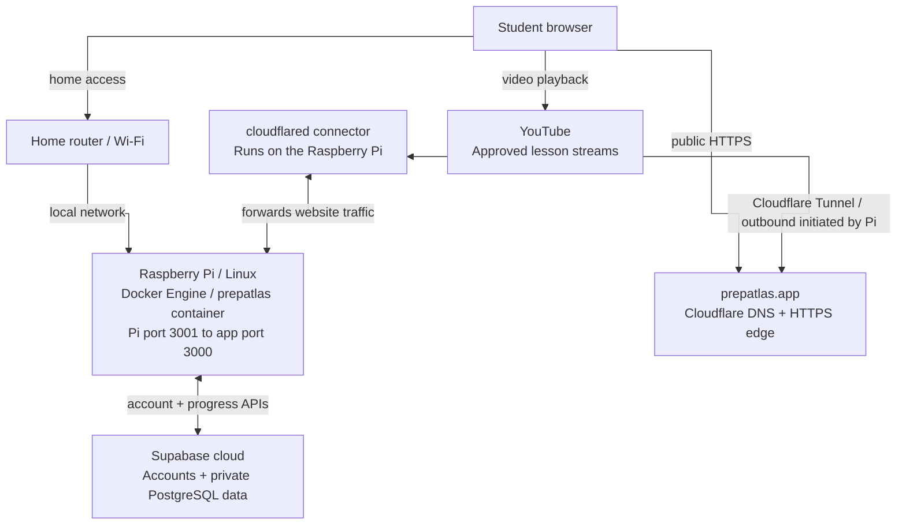
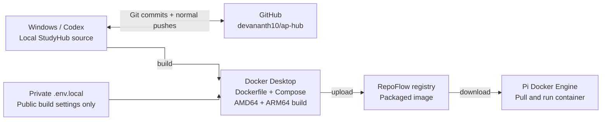
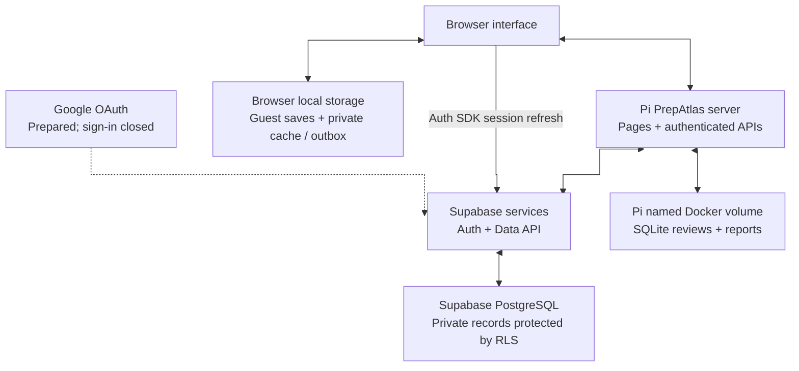
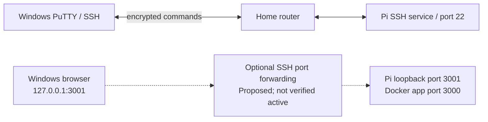

# PrepAtlas architecture - a simple explanation

Prepared October 25, 2026. This explains the existing project; it does not change or deploy the application.

## Start with this story

1. We write PrepAtlas on the Windows computer with Codex helping us.
2. GitHub keeps saved versions of the code, like a notebook with its old pages.
3. Docker packs a working version of the app into an image, like a lunchbox.
4. RepoFlow keeps that box on a shelf until the Raspberry Pi downloads it.
5. The Pi runs the box as a container and sends website pages to the browser.
6. The router connects devices at home and provides their Internet connection.
7. `prepatlas.app` is the easy-to-remember website name. Cloudflare supplies DNS and the public HTTPS edge. Cloudflare Tunnel connects that edge to the Pi's PrepAtlas app.
8. Supabase handles accounts and private cloud progress. YouTube sends the lesson video streams.
9. PuTTY is our remote control for the Pi. It is not where the website lives.

## What each part does

| Part | Easy explanation | Actual role |
| --- | --- | --- |
| Student browser | Window into the classroom | Renders the interface and plays embedded videos; holds guest saves and an account-isolated sync cache. |
| Windows computer | Workshop | Stores the local StudyHub source and runs Codex, development tools and Docker Desktop. |
| Next.js / React / TypeScript / Tailwind | Building materials | Website pages, interactions, typed code and styling. Node.js 24 runs the server; pnpm manages dependencies. |
| Git / GitHub | Versioned notebook | Tested commit checkpoints in `devananth10/ap-hub`; not the live Pi server or Docker registry. |
| Dockerfile / Compose / Docker Desktop | Packing tools | Build the app and configure local containers. AMD64 and ARM64 image variants support the PC and Pi. |
| RepoFlow | Package shelf | Stores `api.repoflow.io/prepatlas/prepatlas/studyhub-app:latest`. Does not serve the website to students. |
| Home router / Wi-Fi | Road junction | Connects home clients and the Pi, and carries outbound Internet traffic. No public port forwarding is assumed. |
| Raspberry Pi / Linux | Small classroom computer | ARM64 host previously verified at `192.168.86.26`. It runs Docker Engine. |
| Docker container `prepatlas` | Running app box | Pi port 3001 maps to app port 3000. Replacing the box can keep its named storage volume. |
| PuTTY / SSH | Remote control + locked connection | Owner command-line access to the Pi, normally on TCP port 22. PuTTY is not a reverse proxy, browser or web host. |
| `prepatlas.app` | Easy address | Public domain name. DNS tells clients which network address to contact. |
| Cloudflare | Address book + HTTPS front door | Authoritative Cloudflare nameservers and a public HTTPS response containing PrepAtlas branding were observed. Cloudflare Tunnel carries website traffic to the Pi, as confirmed by owner-supplied feedback. |
| Cloudflare Tunnel / cloudflared | Private passage to the Pi | The Pi's tunnel connector initiates an encrypted outbound connection to Cloudflare. Requests and responses travel through it to the app. This is separate from PuTTY/SSH; an inbound router port does not need to be opened. |
| Supabase Auth | Account desk | Email sign-in, sessions and recovery. Google OAuth integration is prepared; registration and Google sign-in remain closed in the saved configuration. |
| Google OAuth | Optional sign-in helper | An alternative identity provider through Supabase, not the place where notes or grades are stored. Activation is not assumed. |
| Supabase PostgreSQL | Private cloud notebook | Profiles, courses, notes, topic progress, individual watched videos, instructor preferences, saved resources and completed Practice attempts. |
| Row Level Security (RLS) | Each notebook has its own lock | Database ownership rules complement authenticated API checks. The diagram is not a new live cross-user security certification. |
| Browser local storage | Notebook on one device | Guest data, recoverable caches and pending account edits. Import needs a deliberate user choice. |
| Pi Docker volume / SQLite | Local feedback notebook | `studyhub_feedback` stores `feedback.sqlite` for website reviews and question reports. It is separate from Supabase progress. |
| YouTube | Video library | Streams approved Jeremy Krug, Flipped Math / The Algebros, Mr. Sinn and Heimler lessons directly to the browser. The Pi stores links, not the video files. |
| Private `.env.local` | Configuration envelope | Two public Supabase settings are needed when building the image. Server secrets are runtime-only, excluded from Git and image build context. No secret values appear in the diagram. |

## What is inside PrepAtlas

- Dashboard, course/unit/topic navigation, search and selections.
- Study pages with video tabs, Previous/Next, fullscreen support and original-source links.
- Instructor selection where supported; individual manual watched status.
- Optional local/cloud notes, approved-resource bookmarks and topic completion.
- 2,640 original published MCQs: Chemistry 1,001; Calculus AB 891; Human Geography 748.
- 240 pre-generated Topic Summaries: Chemistry 91; Calculus AB 81; Human Geography 68.
- 319 approved video/resource entries: 102 Chemistry, 81 Calculus and 136 Human Geography.
- First-graded-answer Practice scoring, review/retry and completed-attempt history; unfinished answers remain session-only.
- Personal progress dashboard, account settings, feedback/reviews and question reporting.
- Light/dark themes and mobile layouts. No paid AI backend is involved.

## Verification and boundaries

- On October 25, public DNS for `prepatlas.app` returned Cloudflare addresses and nameservers. Its HTTPS page returned 200 with `server: cloudflare` and PrepAtlas branding.
- **October 25 correction:** owner-supplied feedback confirms that Cloudflare Tunnel connects Cloudflare and the Pi. The overview now shows this as a solid connection and names the `cloudflared` connector on the Pi. This confirmation is separate from our earlier DNS/HTTPS observations; no private tunnel configuration, credentials or service logs were accessed.
- The Pi connector opens the tunnel outbound through the home router, and web requests/responses use that connection. No inbound router-port forwarding is required for Cloudflare Tunnel. The specific tunnel ID, ingress origin URL and whether the connector is a Linux service or separate container were not inspected; the diagram does not invent them.
- The Pi host, running Docker container and port mappings come from previously verified diagnostics and the owner's terminal output. PuTTY usage is owner-reported.
- The repository checkpoint at the start of this documentation task was `f622e3a`. App implementation is shown separately from live-service verification.
- An SSH tunnel was suggested for private loopback login testing. It is separate from the confirmed Cloudflare Tunnel and is not verified active. Successful public-domain login, OAuth, two-device sync and current Pi environment settings were not tested for this diagram. Only this optional private test path remains dashed; the public Cloudflare Tunnel connection is solid.
- Previously, LAN HTTP login failed because its origin differed from `APP_ORIGIN`. Do not remove origin checks or weaken cookie security. A real shared HTTPS origin needs matching app/provider configuration and testing.
- Last known private addresses: PC `192.168.86.28`; Pi `192.168.86.26`. These can change. `127.0.0.1` always means the device on which the browser or command is running.
- Browser guest data belongs to an exact origin. Changing IP, hostname or port does not automatically transfer it.
- Registry publishing is not website deployment. No automatic GitHub-to-Pi deployment pipeline is configured in this project.
- Feedback data on Windows and the Pi are separate. A similarly named Docker volume on two machines is not shared storage.

Cloudflare's [Tunnel documentation](https://developers.cloudflare.com/cloudflare-one/networks/connectors/cloudflare-tunnel/) explains the outbound `cloudflared` connection and why inbound router ports are unnecessary. That provider guidance describes the mechanism; owner feedback establishes its use in this project.

## Editable diagrams

The [PDF](prepatlas-architecture.pdf) has four landscape pages. The four SVG files preserve the same diagrams as editable vector artwork: [overview](prepatlas-architecture-overview.svg), [updates](prepatlas-architecture-updates.svg), [data](prepatlas-architecture-data.svg) and [PuTTY/access](prepatlas-architecture-access.svg). The following Mermaid sources provide another easy way to change labels and layout. All connectors use straight right-angle segments.

### 1. Student access

### 2. Build and update

### 3. Data locations

### 4. Remote control

